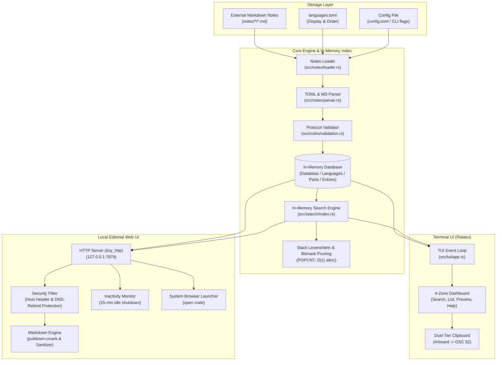

# Architecture & Design

`mycheatsheet` is an offline syntax reference tool built in Rust. It is designed around two core tenets:
1. **Completely Language-Agnostic Core**: The binary contains zero hardcoded languages or syntax patterns. All content is read dynamically from external Markdown files adhering to the [Notes Protocol](NOTES_PROTOCOL.md).
2. **Zero-Latency Dual Interface**: A full-screen interactive Terminal UI (TUI) and an Editorial Web UI served from an in-process, zero-async HTTP daemon.

---

## High-Level Architecture Diagram

---

## Subsystem Breakdown

### 1. Configuration & Path Resolution (`src/config.rs`)
Resolves the notes directory and runtime options using strict priority:
1. **Explicit CLI Flag**: `--notes <path>`
2. **Environment Variable**: `MYCHEATSHEET_NOTES`
3. **User Config File**: `~/.config/mycheatsheet/config.toml` (or `%APPDATA%\mycheatsheet\config.toml`)
4. **Current Working Directory**: `./notes` (auto-detected when running from source or repo)
5. **System/User Data Directory**: `~/.local/share/mycheatsheet/notes` (or `%LOCALAPPDATA%\mycheatsheet\notes`)

### 2. Notes Ingestion & Validation (`src/notes/`)
- **Fault-Tolerant Loader**: Scans subdirectories under the notes root. If an individual file has corrupted formatting or unclosed fences, the loader accumulates a non-fatal warning and continues loading remaining notes.
- **Parser**: Extracts TOML front matter enclosed in `+++` boundaries and slices markdown sections starting with `## `.
- **Protocol Validator (`--check`)**: A standalone verification pipeline that ensures filename prefixes match `part` numbers, non-empty tags exist, and syntax-highlighted code blocks are well-formed.

### 3. Search & Scoring Engine (`src/search/`)
- **In-Memory Inverted Index**: Built on startup. Each entry's title, tags, and code are indexed into searchable tokens.
- **Hardware-Accelerated Bitmask Pruning**: Every indexed word has a 64-bit character mask. Candidate queries run an integer bitwise `&` followed by `POPCNT` instruction to discard mismatched words in 1 CPU cycle before invoking edit distance.
- **Stack-Allocated Levenshtein Distance**: Uses a fixed-size `[0usize; 64]` stack buffer instead of heap allocations (`Vec`), ensuring zero garbage collection and zero memory thrashing during real-time typing.
- **Coverage-Weighted Scoring**:
  - Exact token match: `1.0`
  - Prefix match: `0.75`
  - Typo tolerance (Levenshtein distance $\le 2$): proportional decay.
  - Multi-token coverage: score is multiplied by `(1.0 + matched_tokens / total_tokens)`.

### 4. Terminal Interface (`src/tui/`)
- **Zero Scrollback Contamination**: Uses `crossterm::terminal::EnterAlternateScreen` and cleans up via RAII/drop guards so your terminal history remains undisturbed.
- **Dual-Tier Clipboard Architecture**:
  - Primary: OS clipboard via `arboard` (X11 / Wayland / Windows API).
  - Fallback: ANSI OSC 52 escape sequences sent directly to stdout (`\x1b]52;c;<base64>\x07`), enabling clipboard copies over SSH or in stripped container environments without X11 utilities.

### 5. Web Interface & Security (`src/web/`)
- **Lightweight Daemon**: Powered by `tiny_http`, requiring zero heavy async runtimes (Tokio/Actix).
- **DNS Rebinding Defense**: The server checks the `Host` header on every incoming request. Requests containing arbitrary domain headers are rejected with `403 Forbidden`.
- **Inactivity Auto-Shutdown**: Tracks requests with an atomic timestamp (`AtomicU64`). A background thread monitors idle time and terminates the process after 15 minutes of inactivity to prevent lingering background daemons.
- **Embedded Assets**: HTML templates, CSS styles, and vector icons are embedded at compile time using `include_str!` and `include_bytes!`. No external web server or asset folder is required at runtime.
