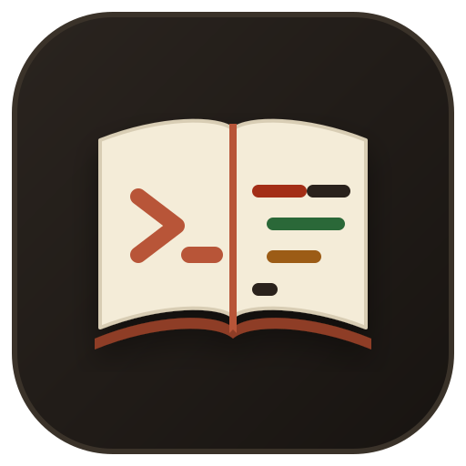

<p align="center">
  
</p>

<h1 align="center">mycheatsheet</h1>

<p align="center">
  <strong>Fast, offline syntax cheatsheet for programming languages in your terminal and browser.</strong>
</p>

<p align="center">
  <a href="https://github.com/mnasies/mycheatsheet/actions/workflows/ci.yml"></a>
  
  
  
  <a href="LICENSE"></a>
  <a href="https://github.com/mnasies/mycheatsheet/releases"></a>
</p>


---

## What is this?

`mycheatsheet` is an app that lets you reference your language cheatsheet notes in either a TUI (terminal user interface) or as a web page. It is meant for you to easily reference basic concepts and syntaxes of languages before switching to any one of them. And for easy accessibility you can open it right from your terminal or from any of your favourite app launcher.

Here is how you can use it:

- **Inside your terminal (`mycheatsheet -t`)**: Fires up a full-screen, keyboard-driven TUI built on `ratatui`. You get real-time fuzzy search as you type, split-pane previews, and one-key yank (`y`) to copy snippets straight into your clipboard (with built-in OSC 52 fallback so it even works smoothly over SSH or tmux).
- **In your browser (`mycheatsheet`)**: Opens a clean, distraction-free editorial interface at `http://127.0.0.1:7878`. It has warm typography, instant search filtering, language tabs, and an automatic 15-minute idle timer so it never clutters background ports when you're done.

It comes pre-loaded with **syntax notes across Go, Rust, C++, and JavaScript** (covering everything from concurrency primitives and memory layout to error handling and async patterns). 

And because the engine is completely decoupled from the notes, you have the ability to add other notes too. Your notes are just plain Markdown files sitting in a folder. You can add Python, Zig, Bash, Dockerfile snippets, or your team's internal tools in five minutes.

---

## Why I built this

In my programming journey switching between different languages like Go, Rust, C++, and JavaScript means constantly gave me some sort of a headache. I would constantly forget the syntax of one language or the other. Like for example: How do I write a type switch in Go again? What was the syntax for rvalue references in C++20? How do I iterate over UTF-8 runes in Rust?

And while in this day and age I could easily download cheatsheet pdfs or ask an LLM I was specifically looking for a reference that I can quickly glance over before switching to a different language and also have the ability to do it very easily right on my terminal or in a web browser. So I decided to build it .

`mycheatsheet` is a single lightweight Rust binary with two modes:
1. **Local web UI**: A warm, distraction-free editorial interface with instant search, syntax highlighting, and copy buttons.
2. **Terminal UI (TUI)**: A full-screen keyboard-driven terminal dashboard built on `ratatui`.

---

## Quick start & Installation

### 1. Download pre-compiled binary (Quickest standalone)
Download the standalone executable from the [Releases](https://github.com/mnasies/mycheatsheet/releases/latest) page:

**Linux**:
```bash
# 1. Download and extract binary
curl -sSLO https://github.com/mnasies/mycheatsheet/releases/latest/download/mycheatsheet-linux-x86_64.tar.gz
tar -xzf mycheatsheet-linux-x86_64.tar.gz
sudo install -m 755 mycheatsheet /usr/local/bin/

# 2. Add notes to default collection (~/.mycheatsheet/notes)
mycheatsheet add /path/to/notes

# 3. Launch
mycheatsheet
```

**Windows (PowerShell)**:
```powershell
# 1. Download release zip
curl.exe -sSLO https://github.com/mnasies/mycheatsheet/releases/latest/download/mycheatsheet-windows-x86_64.zip

# 2. Extract into a programs directory
Expand-Archive mycheatsheet-windows-x86_64.zip -DestinationPath "$env:LOCALAPPDATA\Programs\mycheatsheet"

# 3. Add to User PATH (run once in PowerShell)
[Environment]::SetEnvironmentVariable("Path", "$([Environment]::GetEnvironmentVariable('Path','User'));$env:LOCALAPPDATA\Programs\mycheatsheet", "User")
$env:Path += ";$env:LOCALAPPDATA\Programs\mycheatsheet"

# 4. Add notes and launch
mycheatsheet add C:\path\to\notes
mycheatsheet
```

> [!NOTE]
> Pre-compiled release binaries are standalone executables and do **not** bundle notes inside the binary. To populate your cheatsheets, clone the default `notes/` directory from this repository or download your notes, then run `mycheatsheet add <PATH>` to register them permanently.

---

### 2. Install on Linux (Desktop launcher + bundled notes)
The installer builds or places the binary, deploys the desktop icon to your application launcher, and installs the default 80 notes to `~/.mycheatsheet/notes`.

**Option A — One-line install (no clone needed)**:
```bash
curl -sSL https://raw.githubusercontent.com/mnasies/mycheatsheet/main/scripts/install.sh | bash
```

**Option B — From cloned repository**:
```bash
git clone https://github.com/mnasies/mycheatsheet.git
cd mycheatsheet
./scripts/install.sh
```

Once installed, launch from anywhere or from your application launcher:
```bash
mycheatsheet          # Web mode
mycheatsheet -t       # Terminal UI mode

# To uninstall cleanly:
./scripts/install.sh --uninstall
```

---

### 3. Install on Windows (Start Menu shortcut + bundled notes)
Installs the binary, Start Menu shortcut with embedded icon, user PATH entry, and default notes to `%USERPROFILE%\.mycheatsheet\notes`.

**Option A — One-line install (PowerShell)**:
```powershell
irm https://raw.githubusercontent.com/mnasies/mycheatsheet/main/scripts/install.ps1 | iex
```

**Option B — From cloned repository**:
```powershell
git clone https://github.com/mnasies/mycheatsheet.git
cd mycheatsheet
.\scripts\install.ps1
```

To uninstall:
```powershell
.\scripts\install.ps1 -Uninstall
```

---

### 4. Run directly from source with Cargo
If running inside the repository clone, it automatically detects the bundled `notes/` directory:
```bash
# Open in your default browser (http://127.0.0.1:7878)
cargo run

# Or launch the interactive terminal UI
cargo run -- -t
```

---

## Usage and flags

```text
Usage: mycheatsheet [OPTIONS] [QUERY]

Arguments:
  [QUERY]  Initial search term (e.g. "goroutine" or "go: defer")

Options:
  -n, --notes <DIR>      Path to notes directory (falls back to config or ./notes)
  -t, --terminal         Launch full-screen Terminal UI instead of web browser
  -l, --lang <LANG>      Filter search results by language ID (e.g. "go", "rust")
  -p, --port <PORT>      Localhost web server port [default: 7878]
      --no-open          Do not automatically launch the system web browser
  -c, --check            Strictly validate notes directory against the Notes Protocol
  -h, --help             Print help information
  -V, --version          Print version information
```

### Helpful tricks
- **Fast prefix search**: Type `go: defer` or `lang:rust trait` in either the web or TUI search bar to scope queries instantly.
- **TUI navigation**: Press `/` to focus the search box, `Up`/`Down` or `Ctrl-N`/`Ctrl-P` to pick a result, `Enter` to read the entry, and `y` to yank code to your clipboard.
- **OSC 52 clipboard**: If you use the TUI over SSH or inside tmux where system clipboards are unavailable, `mycheatsheet` falls back to ANSI OSC 52 copy sequences automatically.
- **Instance reuse**: If `mycheatsheet` is already running on port 7878, running `mycheatsheet` again pings `/health`, opens the existing tab, and exits cleanly.

---

## Adding custom languages

`mycheatsheet` has **zero hardcoded languages**. You can add your own notes by creating a directory and following the protocol:

1. **Folder structure**: Create `notes/<language-id>/XX-slug.md`.
2. **Front matter**: Add `+++` TOML headers with `title`, `lang`, `part`, and `tags`.
3. **Entries**: Write `## Pattern Title` followed by explanatory text and fenced code blocks.
4. **Validation**: Run `mycheatsheet --notes /path/to/notes --check` to verify syntax.

📖 Read the complete [Notes Protocol Specification](NOTES_PROTOCOL.md) for directory formats, front matter schemas, and validation rules.

---

## Architecture & Design

`mycheatsheet` is built for sub-millisecond local latency with zero heavyweight async runtime dependencies.

- **Storage**: Plain Markdown files with TOML front matter.
- **Search Engine**: Hardware-accelerated 64-bit character bitmask pruning (`POPCNT`) and stack-allocated Levenshtein distance scoring.
- **Terminal UI**: Alternate screen buffer with `ratatui` and dual-tier clipboard (OS clipboard + ANSI OSC 52).
- **Web UI**: In-process `tiny_http` server, DNS-rebinding protection, CommonMark rendering, and 15-minute inactivity auto-shutdown.

📖 Read the complete [Architecture & Design Document](ARCHITECTURE.md) with subsystem breakdowns and Mermaid diagrams.

---

## Development & Contributing

Contributions are warmly welcomed! Please read our [Contributing Guide](CONTRIBUTING.md) before submitting pull requests.

```bash
# Clone and checkout dev branch
git clone https://github.com/mnasies/mycheatsheet.git
cd mycheatsheet
git checkout dev

# Run all 40 unit and integration tests
cargo test

# Check code formatting & clippy
cargo fmt --check
cargo clippy -- -D warnings

# Validate all shipped notes
cargo run -- --check
```

---

## License

Licensed under the Apache License, Version 2.0 ([LICENSE](LICENSE) or <http://www.apache.org/licenses/LICENSE-2.0>).